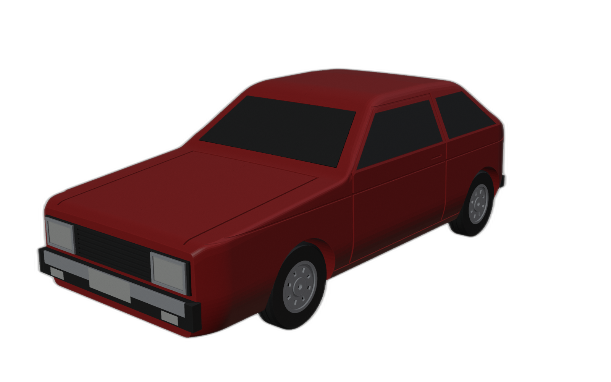
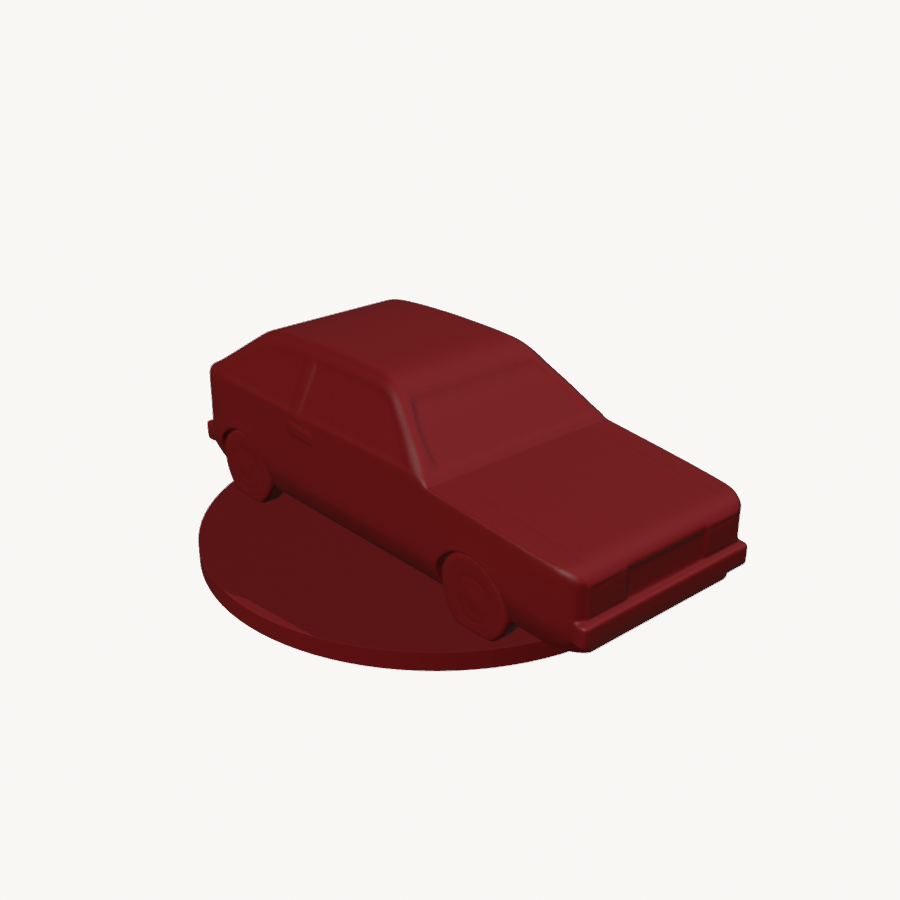

# Imagens em Modelo 3D

Plataforma **local**, que roda neste computador: **uma imagem vira uma peça 3D pronta para imprimir** na Bambu Lab A1 mini. É como o site [hy3d.tencent.ai](https://hy3d.tencent.ai/), mas sem depender dele e personalizada para impressão 3D.

Uso pessoal, para a impressão dos modelos da casa.

| Imagem | Modelo gerado e preparado para impressão |
|---|---|
|  |  |

## Como usar

1. Clique duas vezes em **`iniciar.bat`**. O navegador abre em `http://127.0.0.1:7860`. Deixe a janela preta aberta enquanto estiver usando.
2. Envie a imagem (arrastar, clicar ou colar com Ctrl+V) e dê um nome.
3. Escolha o **tamanho em mm**, a **base plana**, o **pedestal**, o **suporte**, a **cor** e a **camada**.
4. Clique em **✨ Gerar modelo 3D**. Leva ~1 a 2 minutos: a primeira vez demora mais, porque carrega a IA.
5. Baixe o **`modelo_A1mini.3mf`**. Ele abre direto no Bambu Studio, já fatiado.

Mudou só o tamanho, a base ou a cor? Use **↻ Só refazer a impressão**, sem gerar a IA de novo. Todos os modelos ficam na aba **Meus modelos** e na pasta `trabalhos/`.

## Como funciona

```
imagem ──► remoção de fundo ──► IA Hunyuan3D-2 (Tencent, modelo aberto) ──► malha 3D (GLB)
                                          roda na placa de vídeo, ~10 s
malha ──► Blender: escala em mm · malha refeita por voxel (sólido fechado) · redução de triângulos
          · base plana · pedestal opcional · VALIDAÇÃO do STL reaberto · prévias
STL ──► Bambu Studio (linha de comando): perfis OFICIAIS da A1 mini · suporte em árvore
          · CONFERÊNCIA do G-code (template oficial, mesa 65 °C, dentro da mesa) ──► .3mf
```

Por que não fazer "engenharia reversa" do site: a IA por trás dele é **aberta**. Rodar a própria IA aqui é legal, não depende dos servidores deles e permite personalizar tudo.

Do repositório [Impress-o3D_Carros](https://github.com/Buenobim/Impress-o3D_Carros) vieram:
- o validador de STL;
- o `bambu_perfis.py` (perfis oficiais com `include` resolvido);
- a verificação do G-code e o fatiamento numa pasta temporária curta;
- as lições sobre o Blender por linha de comando.

## Instalação (do zero)

**Requisitos:**
- Windows com placa **NVIDIA de 8 GB ou mais** (testado numa RTX 4070 Laptop);
- Python 3.12, Git, **Blender 5.0** e **Bambu Studio 2.05**;
- ~15 GB livres.

```powershell
.\instalar.ps1
```

O instalador:
1. cria o `.venv`;
2. instala o PyTorch com CUDA 12.4;
3. baixa o código oficial do Hunyuan3D-2 (na versão testada) para `vendor/`;
4. instala as dependências nas versões testadas (`requirements.txt`);
5. baixa **só** os arquivos necessários do modelo (~5,3 GB) para `modelos/`;
6. gera os perfis da A1 mini.

## Medições (no computador de teste)

Valores **medidos** na RTX 4070 Laptop (8 GB). Tempo e filamento são **estimativas** do Bambu Studio.

| Etapa | Tempo |
|---|---|
| Carregar a IA (1ª vez) | ~80 s |
| Gerar a malha (qualidade Equilibrada) | ~10 s, pico de 6,6 GB de vídeo |
| Preparar no Blender + fatiar | ~25 a 60 s |
| Exemplo: pinguim de 80 mm com suporte | 1h10 de impressão, ~24 g (estimativa) |

## Limitações

- **Sem textura colorida:** a pintura automática da IA pede 16 GB de vídeo. A peça sai numa cor. Para várias cores, pinte o `modelo.stl` no Bambu Studio (ferramenta de pintura de cores).
- **A IA "imagina" a parte de trás** do objeto. Fotos de frente, com um objeto só e fundo liso, dão os melhores resultados.
- **Texto e desenhos** que são só cor na foto não viram relevo.
- **Peças com partes finas** (antenas, dedos, hastes) podem quebrar em tamanhos pequenos.
- **Nada aqui substitui** olhar a prévia de camadas no Bambu Studio antes de imprimir.

## Licença do modelo de IA

O Hunyuan3D-2 (código e pesos) é da Tencent, sob a **Tencent Hunyuan 3D 2.0 Community License** ([texto](https://github.com/Tencent-Hunyuan/Hunyuan3D-2/blob/main/LICENSE)). Este repositório **não redistribui** o código nem os pesos: o instalador baixa os dois da fonte oficial.

Pontos principais da licença:
- vale fora da União Europeia, do Reino Unido e da Coreia do Sul;
- uso comercial exige licença à parte acima de 1 milhão de usuários por mês;
- os resultados não podem ser usados para treinar outras IAs;
- conteúdo gerado por IA mostrado publicamente deve ser identificado como tal.

## Estrutura

```
iniciar.bat              abre a plataforma
instalar.ps1             instala tudo do zero
app/plataforma.py        interface web (Gradio, em português)
app/gerador.py           IA: imagem -> malha (Hunyuan3D-2 turbo)
app/impressao.py         chama o Blender e o fatiador
app/stl_util.py          leitura/escrita/validação de STL
blender/pos_processar.py malha da IA -> peça imprimível + prévias
impressao/               perfis oficiais da A1 mini + fatiamento verificado
scripts/                 baixar_modelo.py, teste_geracao.py
trabalhos/               (gerado) um diretório por modelo: entrada, GLB, STL, 3MF, prévias, JSONs
vendor/, modelos/        (gerados pelo instalador; fora do git)
```
